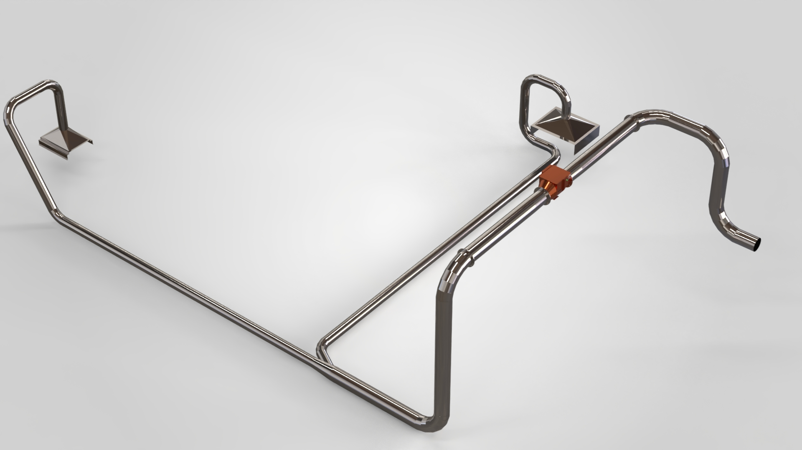
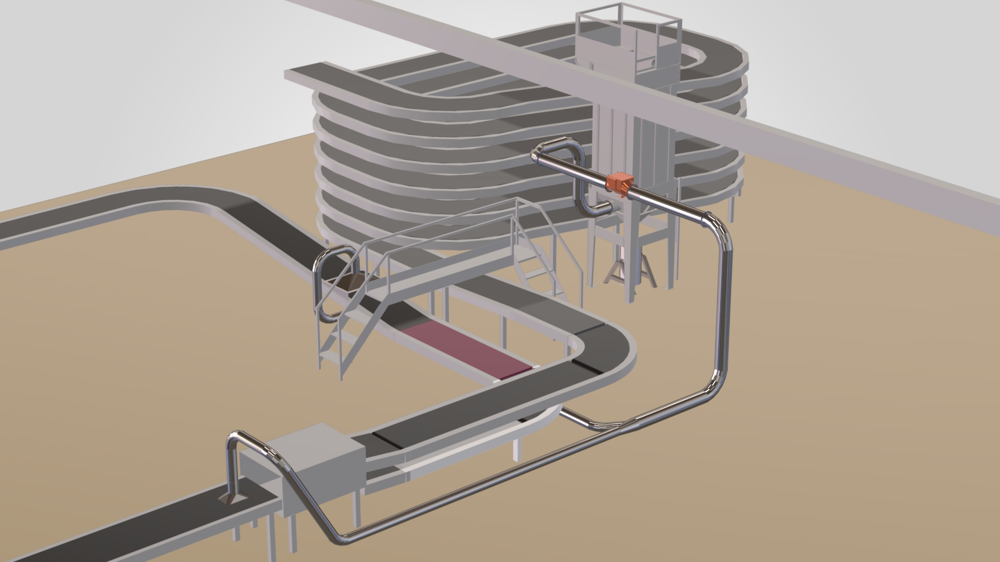
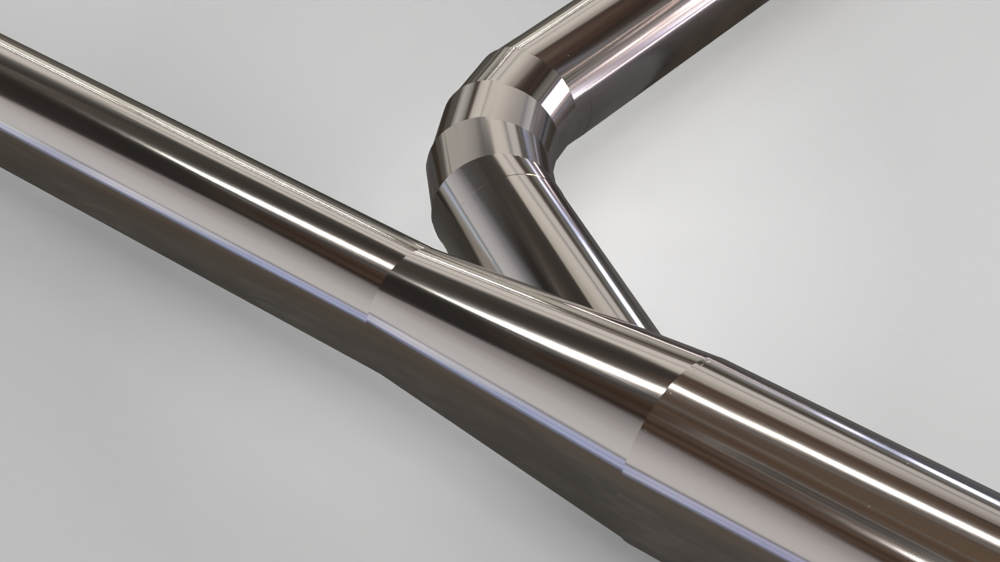
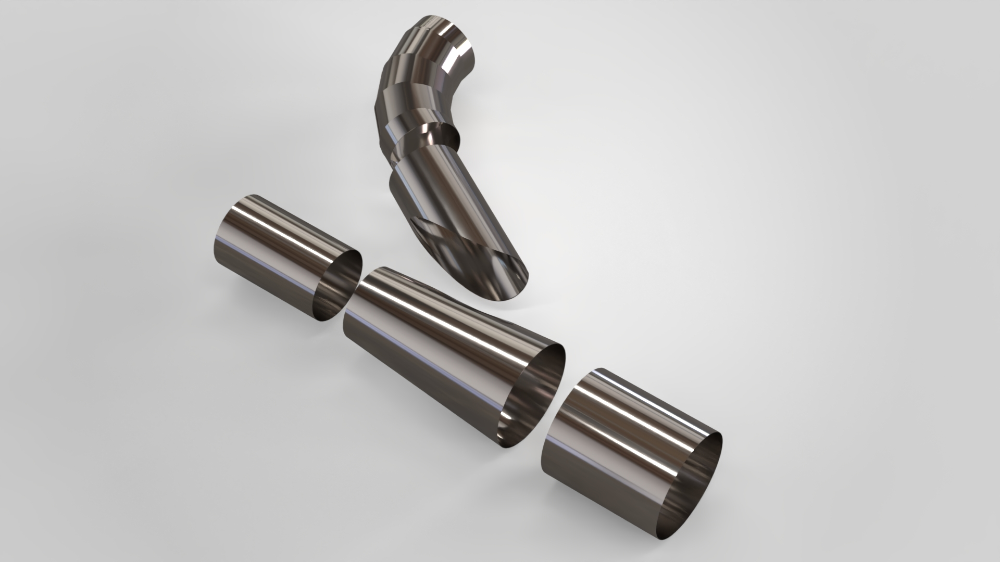
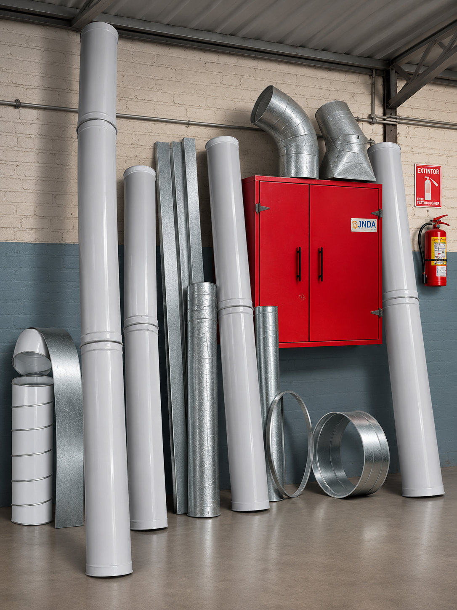
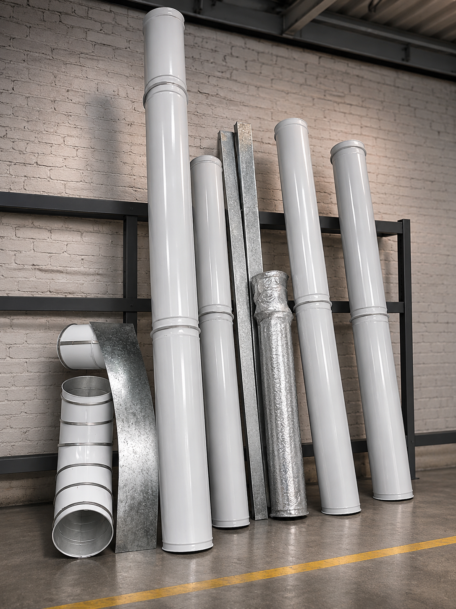
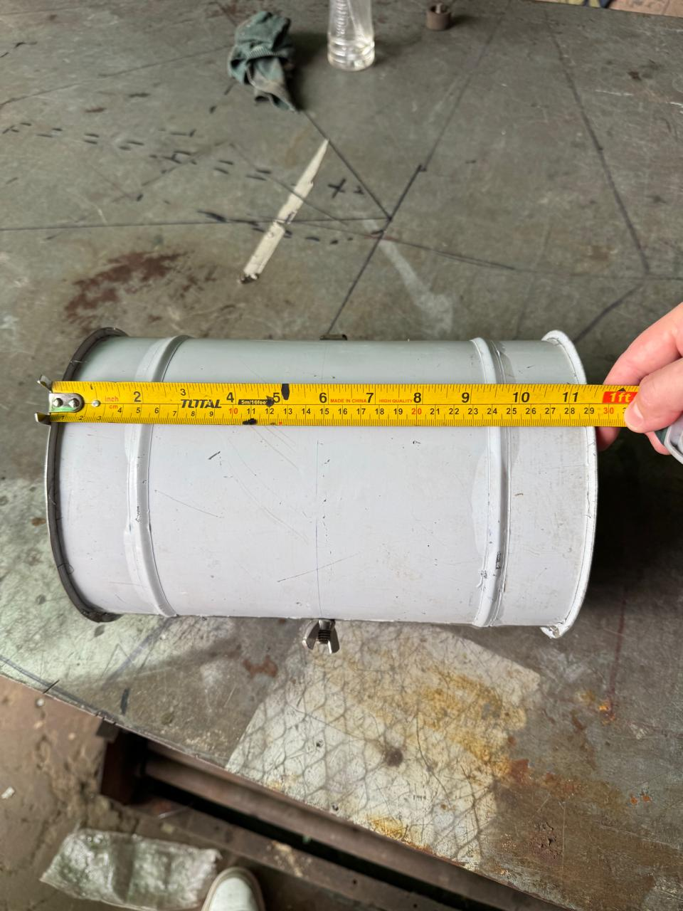

# Industrial Particle Extraction Ductwork | SolidWorks Sheet Metal

**Mechanical Design · Sheet Metal Modeling · Flat Pattern Development · Design for Manufacturing**

## Project Overview

This project presents the mechanical design and 3D modeling of an industrial ductwork system for particle extraction using SolidWorks.

The main focus was the development of rolled sheet metal components, including cylindrical ducts, elbows, conical reducers, and Y-branch connections, with particular emphasis on manufacturability and assembly.

## Plant Integration

The ductwork system was modeled within the industrial plant layout, considering equipment positioning, routing, spatial constraints, and connection points.

## Sheet Metal Design

SolidWorks Sheet Metal tools were used to develop rolled components and complex transition geometries while considering their manufacturing requirements.

The design includes:

- Cylindrical rolled sheet metal ducts.
- Segmented elbows.
- Conical reducers.
- Y-branch connections.
- Component interfaces and assembly configurations.

### Y-Branch & Reducer Design

## Component Assembly & Exploded View

An exploded view illustrates the individual components, geometric transitions, and assembly configuration of the reducer section.

## Flat Pattern Development

Flat patterns were generated from selected sheet metal components to illustrate the transition from three-dimensional geometry to two-dimensional manufacturing layouts.

This process connects CAD modeling with sheet metal fabrication requirements, including cutting and rolling operations.

## Manufacturing & Fabrication

The project connects digital mechanical design with physical sheet metal fabrication.

The following images illustrate fabricated ductwork components and dimensional inspection in a workshop environment.

### Fabricated Components

  
  

*Workshop images digitally enhanced for visual presentation.*

### Dimensional Inspection

  

## Software & Tools

- **SolidWorks** — 3D CAD Modeling & Assembly
- **SolidWorks Sheet Metal** — Rolled Components & Transition Geometries
- **Flat Pattern Development** — Sheet Metal Manufacturing Layouts
- **Rendering Tools** — Materials & Visualization

## Engineering Skills

- Mechanical Design
- Industrial Ductwork Design
- Sheet Metal Modeling
- Design for Manufacturing (DFM)
- Flat Pattern Development
- Assembly Modeling
- Manufacturing Considerations

## Author

**Kevin Vargas García**  
Mechanical Engineer  
Certified SolidWorks Professional — Sheet Metal (CSWP-SM)

[LinkedIn](https://www.linkedin.com/in/kevin-vargas-mechanicalengineer/)
